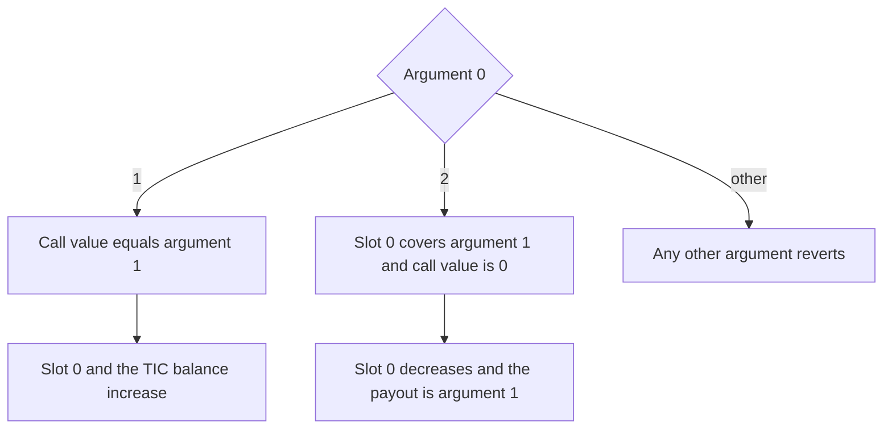
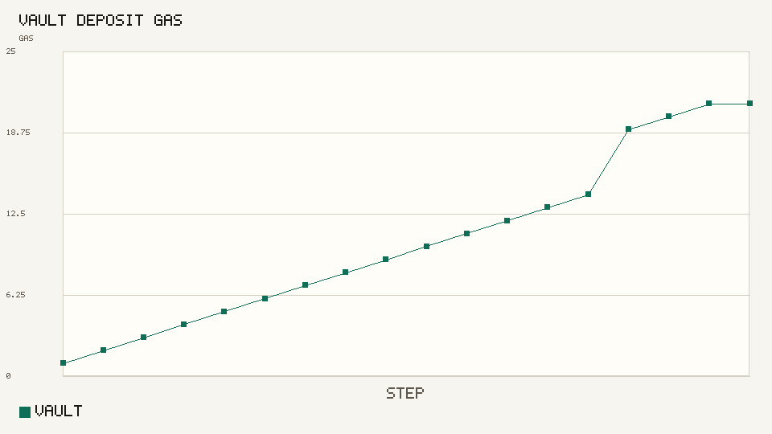
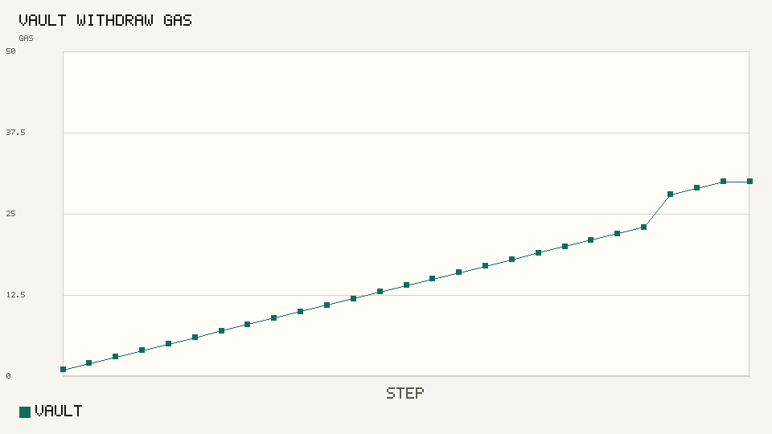
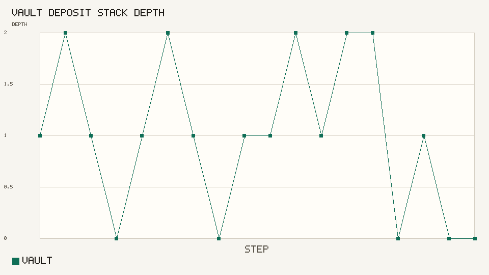
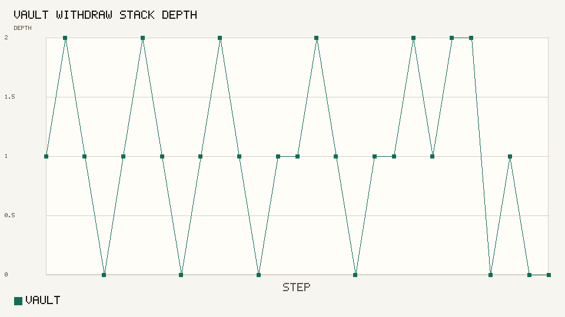
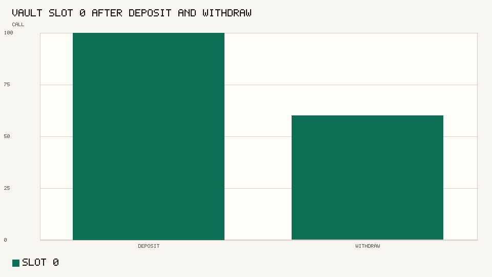
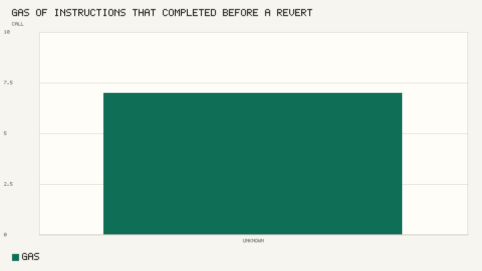

# Timecoin contracts

The Timecoin contract machine. The token is Timecoin. The ticker is TIC. The node that applies these calls is <https://github.com/9lordisgod/Timecoin>.

Organization node: <https://github.com/Timechain-HQ/Timecoin>

A contract account stores bytecode, an ML-DSA-44 capability key, a TIC balance, and integer storage. Only a transaction signed by that capability key can change the account. The machine has no external calls.



`SSTORE` costs 5 gas. `STOP` costs 0. Every other completed opcode costs 1. The limit is 10,000 gas.

```text
inputs = outputs + fee + callvalue - payout
```

```bash
python3 -m unittest tests.test_vm
python3 -m tcvm.cli charts
```














Measured tables are in [docs/charts/README.md](docs/charts/README.md). The block rules are in the [book](https://github.com/Timechain-HQ/book).
